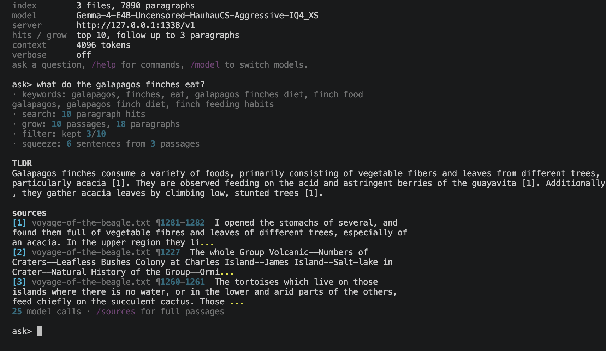

# localsearch

Point it at a folder of books (or notes, or docs), ask "find out about xyz",
and get back a short TLDR built only from what's actually in the files,
with every claim pointing at the paragraph it came from.

Built for the dumbest local models you'd actually run, 1-4B. It works with
any local OpenAI-compatible server - Ollama, [Jan](https://jan.ai), LM
Studio, llama.cpp - and finds whichever one is running by itself.



The design assumption is the same as [local-edit](https://github.com/Jjarrard/local-edit)'s: **the model is unreliable and
the harness has to be the thing that's correct.** Code does all the searching,
cutting and stitching. The model only answers small closed questions, and
code checks every answer.

## Install

Needs Python 3.10+ and a local model server. If you don't have one,
[Ollama](https://ollama.com/download) is the quickest: install it and
`localsearch setup` will offer to download a small model for you.

```bash
pipx install git+https://github.com/Jjarrard/local-search
localsearch setup
```

(No pipx? `pip install git+https://github.com/Jjarrard/local-search` works too.)

`setup` finds running model servers, helps you pick a model (it suggests
the best 1-4B one you have), asks which folder to search, and checks the
model answers. Everything is remembered in `~/.localsearch/config.json`.

## Run it

```bash
localsearch                     # ask questions about your folder
localsearch --folder ~/Books    # switch folder (remembered)
localsearch "what did darwin think about the galapagos tortoises"   # ask once and exit
```

If the server you used last time isn't running, localsearch looks for
another one on the usual ports (Ollama, Jan, LM Studio, llama.cpp) and
switches to it. With no server at all it still searches and shows the best
matching sentences, just without a TLDR.

Working on the code instead:

```bash
python3 -m venv .venv && .venv/bin/pip install -e .
./localsearch-run
```

## What it does with a question

```
"what did darwin think about the galapagos tortoises"
  │
  1. keywords   model lists search words ─────────── fallback: the question's own words
  2. search     SQLite FTS5 / BM25 over every paragraph (pure code, milliseconds)
  3. grow       does the next paragraph continue the topic?
                  heading ................ stop      (rule)
                  mentions the topic ..... continue  (rule)
                  "He / This / However" .. continue  (rule)
                  otherwise .............. ask the model YES/NO
  4. filter     model: "does this help answer it?" YES/NO
  5. squeeze    model: "copy the sentences that help", then each line is
                matched back to a real sentence in the file
  6. TLDR       model writes 3-5 sentences from those notes only, with [n] citations
```

A typical question is 15-20 model calls and ~20 seconds with a 4B model.
Only the last call writes free text; every other call answers YES/NO or
gives a comma-separated list.

## What the harness guarantees

- **Quoted text is always real.** The squeeze step never keeps the model's
  wording. Each line it "copied" is matched by word overlap to an actual
  sentence in the file, and the file's sentence is used instead. Invented
  lines match nothing and are dropped. If nothing survives, it falls back to
  the sentences with the most search words. See `verify_extract` in
  [`pipeline.py`](localsearch/pipeline.py).
- **Every TLDR claim is traceable.** Notes are numbered, the TLDR cites them,
  and `sources` lists `file ¶paragraph` for each. `/sources` shows the full
  passages.
- **Garbage answers degrade, never break.** Unparseable keywords → use the
  question's words. Unclear relevance → keep the passage (losing a real answer
  is worse). Unclear "does it continue?" → stop (when unsure, take less). The
  server dying mid-question → rules only.
- **The model never reads more than it can handle.** Paragraphs are capped
  at 1200 chars, passages at ~3000, and the TLDR notes are trimmed to fit the
  context window (`--context-size`).
- **Junk never becomes a hit.** Title lines, tables of contents and
  back-of-book indexes are dense with search words, so BM25 loves them. Hits
  under 100 chars, mostly-CAPITALS paragraphs and mostly-page-number
  paragraphs are skipped.
- **Thinking models don't think out loud.** It asks the server to disable
  thinking, and strips any `<think>` block that comes back anyway (`--think`
  to allow it).

## No model at all

`--no-llm` (or `/llm off`) skips every model call: search, rule-only growing,
and the best-matching sentences per passage. It's instant, and handy for
checking what the search finds before blaming the model. If the server isn't
reachable at startup, this is what you get automatically.

## Files it reads

| kind                 | extensions                                                    |
| -------------------- | ------------------------------------------------------------- |
| Office               | `.docx` `.xlsx` `.pptx`                                       |
| LibreOffice          | `.odt` `.ods` `.odp`                                          |
| books and documents  | `.epub` `.pdf` `.rtf` `.html` `.htm` `.xhtml`                 |
| text and markup      | `.txt` `.md` `.rst` `.org` `.tex` `.log` `.xml`               |
| data                 | `.csv` `.tsv` `.json` `.jsonl` `.yaml` `.yml` `.toml` `.ini`  |
| email and subtitles  | `.eml` `.srt` `.vtt`                                          |
| code                 | `.py` `.js` `.ts` `.java` `.c` `.cpp` `.go` `.rs` `.rb` `.sh` `.sql`, and more |

Everything except `.pdf` needs only the standard library: the Office and
LibreOffice formats are zip files full of XML underneath. `.pdf` needs
`pypdf`, which is installed with localsearch. Scanned PDFs (pictures of
pages) have no text to find.

How structured files are turned into searchable paragraphs:

- **Spreadsheets** (`.xlsx` `.ods` `.csv`): rows become sentences using the
  header row: `[Sales] Month: Feb; Revenue: 950.5; Region: South.`, so a small
  model doesn't have to line up a bare `Feb | 950.5 | South` with column names
  it saw 40 rows earlier.
- **Slides** (`.pptx` `.odp`): one paragraph per slide, speaker notes included:
  `Slide 3: Title. Bullet. Notes: ...`
- **Subtitles** (`.srt` `.vtt`): grouped into paragraphs that start with a
  timestamp, so a citation tells you where in the video to look.
- **Word tables** become `Header: value` sentences, like spreadsheets.

Not supported: old binary `.doc`/`.xls`/`.ppt`, and `.mobi`/Kindle formats.
Hidden files and folders are skipped.

The index lives in `~/.localsearch/indexes/`, one SQLite file per folder,
so nothing is written into your books folder. Only new or changed files
are re-read, so startup on an indexed folder is instant. `/reindex` picks up
changes mid-session.

## Slash commands

| command             | does                                              |
| ------------------- | ------------------------------------------------- |
| `/status`           | model, folder, index size, settings               |
| `/model [name]`     | pick the model (arrow-key picker if no name)      |
| `/folder <path>`    | search a different folder (Tab completes paths)   |
| `/reindex`          | re-scan the folder for new or changed files       |
| `/sources`          | full passages behind the last answer              |
| `/top <n>`          | how many search hits to look at (default 10)      |
| `/grow <n>`         | max paragraphs to follow past a hit (default 3)   |
| `/llm [on\|off]`    | off = search + extracts only                      |
| `/verbose [on\|off]`| show every grow / filter / squeeze decision       |
| `/help`, `/quit`    |                                                   |

## Flags

`--folder` `--base-url` `--model` `--top` `--max-grow` `--context-size`
`--no-llm` `--think` `--verbose`

Server on a different port or machine, or one that needs an API key? See [docs/custom-api.md](docs/custom-api.md).

## Tests

```bash
.venv/bin/python -m pytest tests/ -q
```

The pipeline tests use a scripted fake model, so they need no server.
